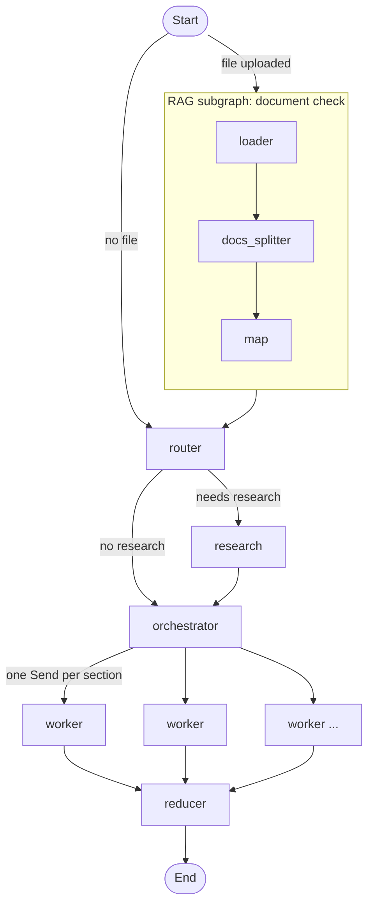

# Blog Agent

An agentic blog writer built with **LangGraph**, **Gemini** and **Streamlit**.

Give it a topic and, optionally, a reference document (PDF, DOCX or TXT). The agent checks the document, decides whether web research is needed, plans an outline around a single thesis, writes every section in parallel, then adds an introduction and conclusion, fact-checks the result and saves it as Markdown. A live pipeline view shows what the agent is doing, and you can cancel a run at any time.

---

## Table of contents

- [Features](#features)
- [How it works](#how-it-works)
- [Project structure](#project-structure)
- [Tech stack](#tech-stack)
- [Setup](#setup)
- [Running the app](#running-the-app)
- [Using the app](#using-the-app)
- [How the frontend works](#how-the-frontend-works)
- [Configuration reference](#configuration-reference)
- [Deploying for free](#deploying-for-free)
- [Free-tier limits and cost per blog](#free-tier-limits-and-cost-per-blog)
- [Known limitations](#known-limitations)
- [Troubleshooting](#troubleshooting)
- [Roadmap](#roadmap)

---

## Features

- **Topic in, blog out.** A structured Markdown blog with a title, introduction, 3–5 body sections and a conclusion.
- **Optional reference document.** The agent rates how useful and reliable it is for your topic, extracts the important facts, and builds the outline around them.
- **Adaptive research.** A router decides between `closed_book`, `hybrid` and `open_book` modes and writes the search queries. Research runs on Tavily, and the results are cleaned into an evidence list.
- **One thesis, planned sections.** The planner states a one-sentence thesis, assigns specific document facts to each section, and lists what each section must *not* repeat.
- **Parallel writing with focused context.** Each section writer gets its own task, the full outline, and only the document passages and web sources most relevant to its section.
- **Grounding and fact-check.** Writers may only use numbers and attributions found in their sources. A final editor pass removes unsupported claims and repetition.
- **Automatic sources list.** Only the web sources the blog actually links to are listed.
- **Live progress.** A pipeline bar and expandable panels show each step’s output as it finishes, including every section as soon as it is written.
- **Cancel button.** Stop a run and return to the form immediately.
- **Result tabs.** Blog, Markdown, Outline, Research, and Document (when you uploaded a file), plus a `.md` download.

---

## How it works

The backend is one LangGraph main graph with a small RAG subgraph for the uploaded document.



### Nodes

| Node | What it does |
|---|---|
| `loader` | Loads the uploaded file (`.pdf`, `.docx`, `.txt`). Other formats raise an error. |
| `docs_splitter` | Splits the document into 1000-character chunks with 200 overlap. |
| `map` | Sends the document pages (with `[p.N]` labels, capped at 80,000 characters) to the model. It rates `usefulness` and `reliability`, extracts key facts, then writes a summary. |
| `router` | Looks at the topic and the document summary, then picks the mode, whether research is needed, and the search queries. |
| `research` | Runs each query on Tavily (5 results each), then asks the model to turn the raw results into a de-duplicated evidence list. |
| `orchestrator` | Builds the `Plan`: title, one-sentence thesis, audience, tone, blog kind, and 3–5 tasks. Each task has a goal, bullets, target words, `doc_points` (document facts to use) and `avoid` (topics covered elsewhere). |
| `fanout` | Sends one `Send("worker", …)` per task so sections are written in parallel. |
| `worker` | Writes one section. It retrieves the document passages and web sources that best match its section (TF-IDF with cosine similarity), then writes using the thesis, the full outline and its own task. |
| `reducer` | Sorts the sections, writes the introduction and conclusion, runs the editor and fact-check pass, appends a Sources list, and saves `<title>.md`. Runs deferred, after all workers finish. |

### State

- `State` (main graph) carries the topic, router decision, evidence, plan, accumulated sections, document results (`usefulness`, `reliability`, `summary`, `extracted_information`, `splitted_docs`) and the final blog.
- `RAGState` (subgraph) carries the file name, loaded and split documents, and the document results.
- `section` is an accumulating list (`Annotated[List[dict], operator.add]`) so parallel workers can each append their own section.

### Why the writers get so much context

Early versions only gave each writer a title and a brief, and the document reached them as one short summary. The writers then leaned on the web search results, repeated each other, and invented numbers. Now every writer receives its goal, bullets, word target, document points and a “do not explain” list, plus the passages most relevant to its section. The editor pass catches what still slips through.

---

## Project structure

```
main/
├── .env                      # API keys (not committed)
├── .gitignore
├── .streamlit/
│   └── config.toml           # forces the light theme the CSS is designed for
├── README.md
├── requirements.txt
├── backend/
│   ├── backend.py            # builds and compiles the LangGraph graph (exports `app`)
│   ├── nodes.py              # node functions, retrieval helpers, reducer steps, RAG nodes
│   ├── schema.py             # Pydantic models: Plan, Task, Bookends, RouterDecision, EvidencePack, ...
│   ├── state.py              # State and RAGState
│   ├── prompt.py             # system prompts for every LLM step
│   └── llm.py                # Gemini client
└── frontend/
    └── frontend.py           # Streamlit UI
```

`.streamlit` is a folder (the name starts with a dot) holding one file, `config.toml`. If you keep everything in a single folder instead, `frontend.py` detects that and adjusts its import path.

---

## Tech stack

- **Orchestration:** LangGraph (graph, subgraph, `Send` fan-out, deferred reducer)
- **LLM:** Google Gemini through `langchain-google-genai`, with structured output via Pydantic
- **Search:** Tavily
- **Document loading:** PyPDF, Docx2txt, TextLoader, and `RecursiveCharacterTextSplitter`
- **Retrieval:** TF-IDF and cosine similarity from scikit-learn (no embedding model needed)
- **UI:** Streamlit with custom CSS (Bricolage Grotesque and Source Serif 4 from Google Fonts)

---

## Setup

### 1. Prerequisites

- Python 3.10 or newer
- A Google AI Studio API key for Gemini
- A Tavily API key
- Internet access (Gemini, Tavily, and Google Fonts for the UI)

### 2. Install dependencies

```bash
python -m venv .venv
# Windows:  .venv\Scripts\activate
# macOS/Linux:  source .venv/bin/activate

pip install -r requirements.txt
```

`requirements.txt` lists only what the code imports directly. Pip installs the rest:

```text
streamlit==1.64.0
langgraph==1.2.12
langchain-core==1.6.9
langchain-community==0.4.2
langchain-text-splitters==1.1.3
langchain-google-genai==4.4.0
pydantic==2.13.5
python-dotenv==1.2.3
scikit-learn==1.9.1
pypdf==6.21.1
docx2txt==0.9
tavily-python==0.8.5
```

If you ever switch to Groq or Ollama again, add `langchain-groq` or `langchain-ollama`.

### 3. Create the `.env` file

Put it in `main/` (or `backend/`). `load_dotenv()` finds it either way.

```env
GOOGLE_API_KEY=your_gemini_key
TAVILY_API_KEY=your_tavily_key
# optional: override the model if Google retires the default
# GEMINI_MODEL=gemini-3.5-flash-lite
```

Add `.env` to `.gitignore` so your keys are never committed.

### 4. Add the theme file

Create `.streamlit/config.toml` in `main/`:

```toml
[theme]
base = "light"
primaryColor = "#3D4FD6"
backgroundColor = "#EEF0F8"
secondaryBackgroundColor = "#FFFFFF"
textColor = "#1B2140"
font = "sans serif"
```

Streamlit reads this file from the folder you launch it in, so always run the app from `main/`.

---

## Running the app

From the `main/` folder:

```bash
streamlit run frontend/frontend.py
```

The app opens at http://localhost:8501. The first start can take a moment while the backend packages load. A “Loading the agent…” spinner shows during that time, and any import error is printed on the page.

---

## Using the app

1. **Enter a topic**, for example “How neural networks scale”.
2. **Optionally upload a reference document** (PDF, DOCX or TXT). If you skip it, the agent relies on its own knowledge and web research.
3. Click **Write blog**. The pipeline bar moves through these steps:
   - **Document:** the file is checked and summarized. Struck through if you uploaded nothing.
   - **Strategy:** the router picks a mode and search queries.
   - **Research:** web search and evidence cleaning. Struck through if the router decides it isn’t needed.
   - **Outline:** the plan appears with its thesis, and each section’s goal, bullets and document points.
   - **Writing:** each section appears in its own panel as soon as it’s written (`2/4`, `3/4`, …).
   - **Assemble:** introduction, conclusion, fact-check pass, sources list, and the saved file.
4. **Cancel generation** at any time. You return to the form with your topic still filled in, and nothing is saved.
5. When it finishes, browse the **Blog**, **Markdown**, **Outline**, **Research** and **Document** tabs. Use **Download .md** to save the blog.
6. Earlier blogs from this session are listed under **Past blogs** in the sidebar. **New blog** starts again.

The reducer also writes `<blog_title>.md` into the folder you ran the app from.

---

## How the frontend works

- **Background thread.** Each run is a `Job` that runs `app.stream(..., stream_mode="updates")` in a background thread. The thread never touches Streamlit; it only pushes updates into a queue.
- **Polling loop.** The page drains the queue every 0.4 seconds, redraws the pipeline bar and panels when something changed, and shows a running timer.
- **Cancel.** Clicking Cancel sets a flag, drops the job and returns to the form. A model call that is already in flight can’t be killed, so it finishes in the background and its output is discarded. No further steps run.
- **Session state.** The current job, the history of finished blogs and the last topic live in `st.session_state`, so the page survives reruns. The sidebar buttons are disabled while a blog is generating.
- **Styling.** Custom CSS handles the colors, fonts, the pipeline bar, the reading sheet and the buttons. The reading sheet uses `st.container(key=...)`, which needs Streamlit 1.39 or newer.
- **Safe loading.** `load_app()` imports the backend behind a spinner, so an import problem shows up as a readable error instead of a blank page.

---

## Configuration reference

| What | Where | Notes |
|---|---|---|
| Model | `llm.py`, `GEMINI_MODEL` environment variable | Default `gemini-3.5-flash-lite`. Retries up to 6 times on rate-limit errors. |
| Prompts | `prompt.py` | `ROUTER_PROMPT`, `RESEARCH_PROMPT`, `ORCHESTRATOR_PROMPT`, `WORKER_PROMPT`, `DOCUMENT_INTEGRITY_PROMPT`, `DOCUMENT_SUMMARY_PROMPT`, `BOOKENDS_PROMPT`, `EDITOR_PROMPT` |
| Search results per query | `nodes.py` → `research` (`max_results = 5`) | |
| Chunk size and overlap | `nodes.py` → `docs_splitter` | 1000 and 200 |
| Document text cap | `nodes.py` → `DOC_CHAR_LIMIT` | 80,000 characters sent to the document check |
| Chunks and sources per section | `nodes.py` → `worker` | 5 document chunks, 4 web sources |
| Sections per blog | `schema.py` → `Plan.tasks` | 3 to 5 |
| Bullets per section | `schema.py` → `Task.bullets` | 3 to 6 |
| Upload types | `nodes.py` → `loader`, `frontend.py` → `ALLOWED_TYPES` | pdf, docx, txt |
| Colors | `frontend.py` (`:root` CSS variables) and `.streamlit/config.toml` | change both together |

---

## Deploying for free

The app can’t host its own model on a free server, so it uses hosted Gemini. **Streamlit Community Cloud** is the simplest free host.

1. Put the project on GitHub. Make sure `.gitignore` contains `.env`, `.venv` and generated `*.md` blogs.
2. Keep `requirements.txt` in the repo root.
3. At share.streamlit.io choose **New app**, pick the repo and branch, and set the main file path to `frontend/frontend.py`.
4. Open **Advanced settings → Secrets** and add:
   ```toml
   GOOGLE_API_KEY = "your_gemini_key"
   TAVILY_API_KEY = "your_tavily_key"
   ```
   Secrets are available to the code as environment variables, so `llm.py` and Tavily find them automatically.
5. Deploy. Your `.streamlit/config.toml` in the repo root is used automatically.

Things to know:
- Files written by the reducer go to temporary disk and disappear on restart. Users download blogs from the page.
- A public app uses *your* Gemini and Tavily quota for every visitor.
- Free hosts put idle apps to sleep, so the first visit after a quiet period is slow.

---

## Free-tier limits and cost per blog

One blog makes roughly **8 to 13 model calls**: the document check (2, only with a file), the router, research cleaning, the planner, one call per section (3–5), the introduction and conclusion, and the editor pass. Tavily is also called once per search query.

Google doesn’t publish a fixed free-tier table any more. Open Google AI Studio to see the exact requests-per-minute and requests-per-day limits for your key and model. If you hit limits:
- The client already retries rate-limit errors up to 6 times.
- Reduce parallel section writers by passing `config={"max_concurrency": 2}` to `app.stream(...)` in `Job._run`.
- Set `GEMINI_MODEL` to another Flash-Lite model, which usually has its own quota.

Free-tier prompts may be used by Google to improve its products, so avoid uploading private documents.

---

## Known limitations

- **Long documents.** The document check sends up to 80,000 characters in one prompt. Very long PDFs are cut off.
- **Reliability rating.** The model can’t independently verify a document, so it will often answer “Ambiguous”. Treat the rating as a hint, not a verdict.
- **Cancel isn’t instant for the model.** The UI returns immediately, but a call already in flight runs to its end.
- **History is per session.** Past blogs vanish when you refresh the page. Only the saved `.md` files persist.
- **No checkpointing.** The graph has no checkpointer, so runs can’t be resumed.
- **Structured output on Gemini.** Strict list-size rules in the schema (for example `min_length` and `max_length`) can occasionally make Gemini’s structured output fail. Removing them is the usual fix.
- **Streamlit internals.** The CSS targets Streamlit’s `data-testid` attributes, which can change between versions.
- **Deprecated package.** `langchain-community` prints a deprecation notice. It still works, but the loaders and Tavily tool may move to other packages in the future.

---

## Troubleshooting

| Problem | Likely cause and fix |
|---|---|
| Page just keeps loading | The backend import is slow or failing. Check the terminal for errors. `frontend.py` loads the backend behind a spinner and prints import errors on the page. |
| `404 NOT_FOUND ... model ... no longer available` | Google retired the model name. Set `GEMINI_MODEL` in `.env` or Streamlit secrets to the replacement named in the error message. |
| `'list' object has no attribute 'strip'` | A Gemini reply’s `.content` is a list of blocks. Use the `text_of()` helper in `nodes.py` wherever you read model text. |
| `429` or quota errors | Free-tier limit reached. Wait for the reset, lower concurrency, or switch model (see above). |
| Text or buttons are hard to read | The light theme isn’t loading. Check that `.streamlit/config.toml` exists (not `config.toml.txt`), run from `main/`, and restart Streamlit. |
| `ModuleNotFoundError: state` (or `nodes`, `schema`) | The backend folder isn’t on the import path. Keep the `backend/` and `frontend/` folders side by side, as shown above. |
| Authentication error | `GOOGLE_API_KEY` or `TAVILY_API_KEY` is missing or wrong. Check `.env` or Streamlit secrets. |
| `ValueError: Unsupported file format` | Only `.pdf`, `.docx` and `.txt` are supported. |
| The router returns a mode that fails validation | Make sure `schema.py` uses `'closed_book'`, matching `ROUTER_PROMPT`. |
| Blog ignores the uploaded document | The model may have rated it as not useful for the topic. Open the **Document** tab to see `usefulness` and the extracted facts. |
| Sidebar buttons are greyed out | A blog is being generated. Cancel it or wait for it to finish. |
| `.streamlit` folder won’t create in File Explorer | Use a terminal (`mkdir .streamlit`) or VS Code. |

---

## Roadmap

- Use real embeddings and a vector store for retrieval over long documents.
- Add a LangGraph checkpointer (for example SQLite) so blogs and runs persist across sessions.
- Add per-claim citations that link statements to evidence items.
- Let the user pick tone, audience and length in the UI.
- Add regeneration of a single section.
- Save generated blogs into a `blogs/` folder instead of the working directory.
